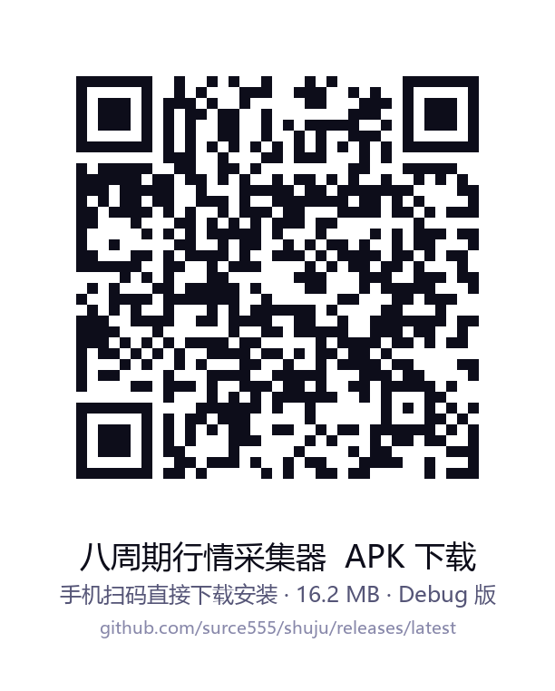

# 八周期行情采集器

专为 `crypto-mtf-analyzer` AI 交易技能设计的 Android 原生数据采集 App。

## 功能特性

- 📊 **8 大时间周期**：月线、周线、三日线、日线、12H、6H、4H、1H
- 💰 **双币种支持**：BTCUSDT + ETHUSDT（含实时 ETH/BTC 汇率）
- 🔄 **多节点自动容灾**：Binance镜像 → Binance主站 → OKX
- ⚡ **高性能并发采集**：协程并发 16 个 K 线队列，2 秒内完成
- 📈 **精准指标计算**：EMA20/50/200、RSI(14)、MACD(12,26,9)、BOLL(20,2)、ATR(14)
- 💸 **资金费率**：实时合约资金费率采集
- 📋 **一键复制**：格式化 Markdown 文本直接喂给 AI
- 🐛 **调试日志**：内置日志面板，一键复制 Bug 信息

## 直接下载 APK（公开，无需登录）

📱 **手机扫码直接下载安装：**

| 下载方式 | 链接 |
|---|---|
| 直接下载 APK（始终最新） | **[app-debug.apk](https://github.com/surce555/shuju/releases/latest/download/app-debug.apk)** |
| 查看全部版本 | [Releases 页面](../../releases/latest) |

> 仓库与 Release 均为公开，任何设备无需登录即可匿名下载。
> 手机下载后需开启「允许安装未知来源应用」。

## 技术栈

- Kotlin + Jetpack Compose (Material 3 暗黑金融风)
- OkHttp3 + Kotlin Coroutines
- minSdk 26 / targetSdk 34

## 使用方法

1. 安装 APK（需开启允许未知来源）
2. 选择数据源（默认 Binance镜像，无需翻墙）
3. 点击「一键采集 8 周期实盘数据」
4. 等待约 2 秒后，点击「一键复制 AI 分析文本」
5. 粘贴到 AI 对话框，让 AI 执行 `crypto-mtf-analyzer` 分析

## GitHub Actions 自动编译

每次 push 代码后，GitHub Actions 自动编译 APK 并发布到 Releases。
